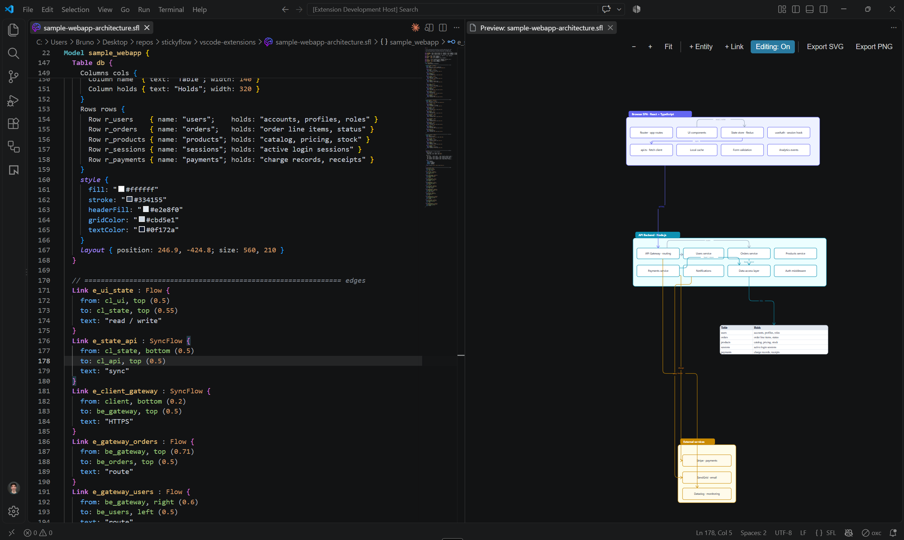
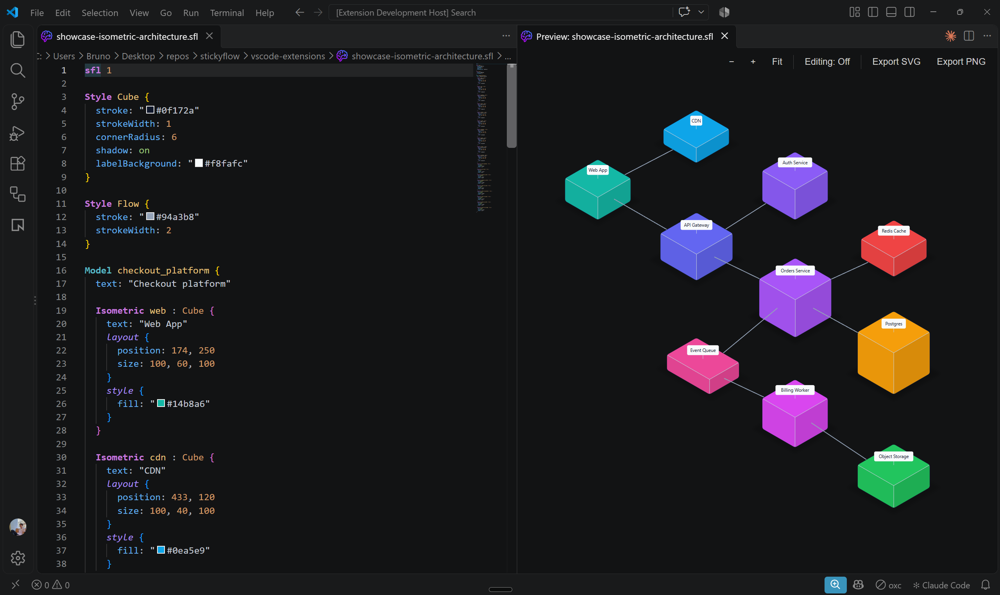

<p align="center">
  <picture>
    <source media="(prefers-color-scheme: dark)" srcset="assets/banner-dark.png">
    
  </picture>
</p>

<div align="center">

# vscode-sfl-preview

**Live, editable previews of SFL diagrams in VS Code.**

</div>

Open an `.sfl` file, hit the preview button, and the diagram renders right
next to its source. It updates as you type, and with edit mode on you can
drag, resize and connect shapes on the canvas while the extension writes the
changes back into the file for you. It uses the same renderer as the
StickyFlow app, [`stickyflow.js`](https://github.com/Stickyflow/stickyflow.js).

This is the companion to [`vscode-sfl`](https://github.com/Stickyflow/vscode-sfl),
which handles language support (highlighting, diagnostics, completion, …).
Installing either one installs both.

## Why vscode-sfl-preview?

Writing a diagram as text is great for diffs and reviews, but you still
want to see what you're building. Switching to another app just to check a
layout breaks the flow, and a screenshot is out of date the moment you
change a line.

The preview keeps the picture and the text side by side and in sync. Click
a shape and the editor jumps to its block; move the cursor and the shape
lights up. Some things are just easier by hand, like nudging a box or
resizing a table. For those, turn on edit mode and do it on the canvas: the
result is plain SFL in your file, and Ctrl+Z undoes it like any other edit.

<p align="center">
  
</p>

## Installation

Install **StickyFlow SFL Preview** from the
[VS Code Marketplace](https://marketplace.visualstudio.com/items?itemName=StickyFlowLab.vscode-sfl-preview), or from inside VS Code:

1. Open the Extensions view (Ctrl/Cmd+Shift+X).
2. Search for **StickyFlow SFL Preview**.
3. Click **Install**.

This also installs [StickyFlow SFL](https://marketplace.visualstudio.com/items?itemName=StickyFlowLab.vscode-sfl).

## Usage

Open an `.sfl` file and run one of:

- **SFL: Open Preview** to replace the current editor.
- **SFL: Open Preview to the Side** to open it next to the editor (also the
  preview icon in the editor title bar).

### Navigating

- **Zoom** with the `−` / `+` / `Fit` buttons, or Ctrl/Cmd+scroll.
- **Pan** by dragging the background, middle-dragging, or scrolling
  (Shift+scroll for horizontal).
- **Select** a shape or link to reveal its block in the editor. It works the
  other way too: moving the cursor in the editor selects the matching shape.

### Editing on the canvas

Edit mode is off by default, so panning and clicking around never changes
your file. Toggle **Editing: On** in the toolbar, then:

- **Drag** entities, frames, swimlanes, tables and charts. A frame carries
  its contents with it.
- **Resize** a selected shape from its corner handles.
- **Double-click** a shape to edit its text.
- **Drag a link's endpoint** to reconnect it.
- **Delete** / **Backspace** removes the selection.
- **+ Entity** adds a shape in the middle of the view. **+ Link** connects
  two shapes: click the source, then the target (Escape cancels).
- **Route** cycles a selected link between orthogonal, curved and straight.
- **Isometric objects**: resize along each axis with the arrow handles, drag
  the label to move it, and click a cube-face **+** bubble to add a connected
  copy in that direction. **+ Link** between two isometric objects creates a
  `Connection` attached to the faces that point at each other.

Every change becomes a normal text edit in the `.sfl` file, so it shows up
in the undo stack and in your diff.

### Isometric diagrams

`Isometric` blocks draw 3D objects and `Connection` blocks join them face to
face. For software architects this is the view between a whiteboard sketch
and a cloud console: the system's shape at a glance, still precise enough to
review.

- **Tiers read as tiers.** Edge, services and data each get their own row,
  so where a request enters and where state lives is obvious at a glance.
- **Size carries meaning.** Width, height and depth are separate values, so
  a stateful store can stand taller than a stateless service, or a shared
  queue sit wider than a single worker.
- **Dependencies have a direction.** A connection leaves one face and enters
  another, keeping the main request path, side calls (auth, caching) and
  async work through a queue visually apart.
- **It lives next to the code.** The diagram is plain SFL in your repo, so an
  architecture change lands in the same pull request as the code behind it,
  and reviewers see a diff instead of a stale image.

Typical uses: deployment and service topology overviews, design reviews and
ADRs, onboarding docs, and before/after views of a migration.

<p align="center">
  
</p>

### Seeing what changed

When the file changes from outside the preview (you typed in the editor, or
something else rewrote the file), the shapes that were added or changed
briefly flash. It's an easy way to see exactly what an edit touched, and
what it didn't. Your own canvas edits don't flash, since you just watched
them happen.

### Style templates

**Style** opens vscode-sfl's template picker (Night Lime, Midnight Violet,
Graphite Mono, Paper Navy, Charcoal Pastel, Evergreen Ledger, Neon Dispatch,
Calm Sage, Ember Noir, Studio Light, Violet Circuit, Deep Sea, Prism,
Indigo Wire) for the previewed file. While the picker is open, the
highlighted template shows live in the preview, so you can arrow through
them; Esc goes back to the file as it was. The picked
template is written into the `.sfl`, so it's one undo step and shows up in
your diff. Its canvas color becomes the preview's background. **None** (the
last entry, once the file has a template) removes it, and the preview
follows the VS Code theme again.

### Exporting

**Export SVG** and **Export PNG** save the whole diagram, not just the part
currently in view. PNGs are rendered at 2x for a crisp result. With a style
template applied, both exports use its canvas color as the background.

**Export MD** saves a Markdown note: a heading named after the file and the
diagram's source in a fenced `sfl` block, ready to drop into an Obsidian
vault (where the SFL plugin renders it live) or any docs folder.

**Export TOON** saves what the diagram says, not how it looks: its nodes
(id, kind, shape, text, frame, group), links (from, to, text, condition),
isometric connections and groups, in
[TOON](https://toonformat.dev), a compact format for LLM prompts. Columns
nobody uses are left out, so a simple flow stays a few short tables:

```
nodes[3]{id,kind,shape,text}:
  start,start,pill,Start
  check,decision,diamond,Valid?
  done,end,pill,Done
links[2]{id,from,to,condition}:
  l1,start,check,null
  l2,check,done,yes
```

The preview ships its own copy of Inter, the font the style templates (and
stickyflow.js's defaults) use, so diagrams look the same whether or not
Inter is installed. Exports embed the parts of it their text needs (about
65 KB for Latin text), so an exported SVG renders the same anywhere.

## Development

The preview uses a prebuilt copy of `stickyflow.js`, so build that first:

```bash
cd ../stickyflow.js && npm run build
cd ../vscode-sfl-preview
npm install
npm run compile
```

`npm run compile` copies `stickyflow.js/dist` into `media/stickyflow/`, then
compiles the extension (`src/` → `out/`) and the webview code
(`webview/` → `media/webview/`). `npm run watch` watches the extension
only; after changing anything under `webview/`, re-run `npm run compile`
or use `npm run watch:webview`.

Press **F5** with this folder open to launch an Extension Development Host.

### Tests

```bash
npm test                 # unit tests (vitest), no browser needed
npm run verify:webview   # end-to-end check in headless Chrome
npm run check            # compile + both of the above
```

The unit tests cover the SFL text patchers and the drag/resize geometry.
`verify:webview` loads the real webview in Chrome and exercises panning,
edit mode, dragging, resizing and link routing. It needs a local Chrome
(set `CHROME_PATH` if it's somewhere unusual) and skips itself if none is
found. Run it (or `npm run check`) after touching `getWebviewHtml.ts` or
anything in `webview/`.

## 🙌 Contributing

The preview is a thin layer over `stickyflow.js`, which makes it a good
place to start. Two goals behind that:

- 🌱 **Grow it.** More canvas gestures, better touchpad support, extra
  export options, whatever's missing from your workflow: PRs are welcome.
- 🛠️ **Make it yours.** The webview code lives in `webview/`, split into
  small modules per interaction, so a focused change doesn't require
  understanding the whole extension first.

See [Development](#development) to get set up. Found a bug or have an idea?
Open an issue or send a PR: small and focused beats big and perfect. We'll
review, comment if needed, and merge when we're happy with it. 🚀
